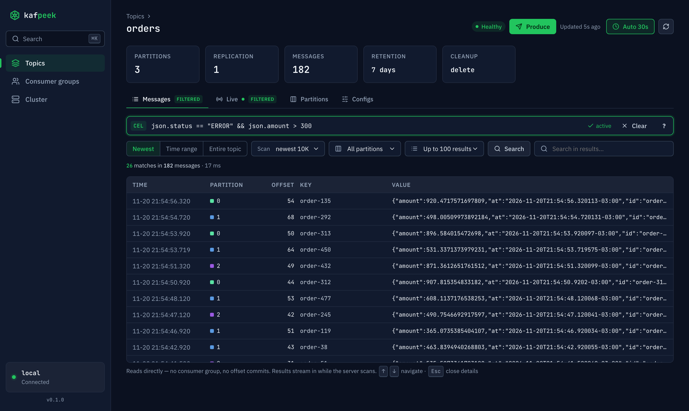

<p align="center">
  <b>English</b> · <a href="README.pt-BR.md">Português</a>
</p>

<div align="center">


# kafpeek

**Peek inside your Kafka topics.** A lightweight UI for Apache Kafka: a single binary (or a ~11 MB Docker image using ~18–21 MB of RAM)
with server-side message search using CEL filters, live tail, and AWS MSK IAM support.

[](LICENSE)
[](go.mod)
[](web/package.json)
[](https://hub.docker.com/r/stolato/kafpeek)
[](https://github.com/stolato/kafpeek/actions/workflows/release.yml)



</div>

## Why kafpeek?

- **Find the right message fast**: [CEL](https://cel.dev) filters run **on the server**, so only matching messages
  travel to the browser. Streaming search over the most recent messages, a time range, or the **entire topic**,
  with real progress and a Stop button.
- **Live tail** in real time, with the same filters.
- **Non-intrusive**: reads never use a consumer group and never commit offsets.
- **One binary, nothing else**: Go backend ([franz-go](https://github.com/twmb/franz-go) + chi) with the Angular
  frontend embedded. No JVM, no database, no external dependencies.
- **Connects to any cluster**: PLAINTEXT, TLS, mTLS, SASL/PLAIN, SCRAM, and **AWS MSK IAM** (access keys,
  profile/SSO, or the ECS/EKS/EC2 role).
- **Schema Registry**: Avro, Protobuf, and JSON Schema messages are decoded to JSON on the server, so the viewer
  and CEL filters (`json.customer.id == "42"`) work on them too.
- Topics, partitions, configs, and consumer groups with lag (and trend).
- **Manage topics** (create, delete, add partitions, edit configs, purge messages) and **reset consumer group
  offsets** with a dry-run preview, plus **produce** messages, all with protection for production clusters, or
  **read-only** mode.
- Secure by default: login (Basic Auth), CSRF and DNS rebinding protection, strict CSP, non-root user.

---

## Table of contents

1. [Quick start](#quick-start)
2. [Supported connections](#supported-connections)
3. [Docker in detail](#docker-in-detail)
4. [Environment variable reference](#environment-variable-reference)
5. [Security and login](#security-and-login)
6. [Filters (CEL)](#filters-cel)
7. [Schema Registry](#schema-registry)
8. [Producing messages](#producing-messages)
9. [Managing topics and offsets](#managing-topics-and-offsets)
10. [Development](#development)
11. [API](#api)
12. [Architecture](#architecture)
13. [Contributing](#contributing)
14. [License](#license)

---

## Quick start

**Just want to try it?** Start a local Kafka and the UI in containers:

```bash
git clone https://github.com/stolato/kafpeek.git && cd kafpeek
make demo        # Kafka + kafpeek; open http://localhost:8090
make seed        # optional (requires Go): sample topics with fake events
```

**Connect to your cluster with Docker:**

```bash
docker run -d --name kafpeek \
  -p 127.0.0.1:8090:8090 \
  -e KAFKA_CLUSTER_NAME=my-cluster \
  -e KAFKA_BROKERS=broker1:9092,broker2:9092 \
  -e KAFKA_AUTH=none \
  stolato/kafpeek:latest
```

The image is published to [Docker Hub](https://hub.docker.com/r/stolato/kafpeek) (`stolato/kafpeek`) and to the
GitHub Container Registry (`ghcr.io/stolato/kafpeek`), for `linux/amd64` and `linux/arm64`.

Open **http://localhost:8090**. For TLS, SASL, or MSK, see [Supported connections](#supported-connections).

**Binary, without Docker** (requires Go 1.27+ and Node 24+):

```bash
make build       # builds bin/kafpeek with the UI embedded
KAFKA_BROKERS=localhost:9092 ./bin/kafpeek
```

---

## Supported connections

Summary: pick the row that matches your cluster and follow the corresponding section:

| Scenario | `KAFKA_AUTH` | TLS | Examples |
|---|---|---|---|
| [No authentication, no TLS](#1-plaintext-no-authentication) | `none` | no | Local Kafka, dev, internal network |
| [TLS only (encryption)](#2-tls-without-authentication) | `none` | yes | MSK on port 9094 without client auth |
| [TLS with a private CA](#3-tls-with-a-private-ca) | any | yes + `KAFKA_TLS_CA_FILE` | Self-hosted Kafka, Strimzi, Aiven |
| [mTLS (client certificate)](#4-mtls-client-certificate) | `none` | yes + cert/key | MSK mTLS (9094/9194), Strimzi, Aiven |
| [SASL/PLAIN](#5-saslplain) | `plain` | yes (default) | Confluent Cloud, Azure Event Hubs |
| [SASL/SCRAM](#6-saslscram-sha-256--sha-512) | `scram-sha-512` / `scram-sha-256` | yes (default) | MSK SCRAM (9096/9196), Aiven, Redpanda, Strimzi |
| [AWS MSK IAM](#7-aws-msk-with-iam) | `aws-iam` | yes (required) | Provisioned MSK (9098/9198), MSK Serverless |

General rules:
- `KAFKA_BROKERS` accepts several brokers separated by commas (`host:port`). One reachable broker is enough; the rest are discovered.
- **TLS turns on automatically** when SASL (`plain`, `scram-*`, `aws-iam`) or certificates are configured.
  Force it with `KAFKA_TLS=true|false`.
- Reads never use a consumer group or commit offsets, so they don't interfere with your real consumers.

### 1) PLAINTEXT (no authentication)

```env
KAFKA_BROKERS=kafka:9092
KAFKA_AUTH=none
```

### 2) TLS without authentication

Encrypted traffic, no client credentials. The broker certificate is validated against the system's public CAs
(included in the image).

```env
KAFKA_BROKERS=b-1.mycluster.xxxx.kafka.us-east-1.amazonaws.com:9094
KAFKA_AUTH=none
KAFKA_TLS=true
```

### 3) TLS with a private CA

When the broker uses a certificate issued by an internal CA (the typical error without this is
`x509: certificate signed by unknown authority`):

```env
KAFKA_TLS_CA_FILE=/certs/ca.pem        # PEM; may contain several certificates
# KAFKA_TLS_SERVER_NAME=kafka.internal # only if the name in the certificate differs from the broker host
```

The CA is **added** to the system CAs. It works with any `KAFKA_AUTH` (e.g., SCRAM + private CA).

- **Strimzi**: `kubectl get secret <cluster>-cluster-ca-cert -o jsonpath='{.data.ca\.crt}' | base64 -d > ca.pem`
- **Aiven**: download `ca.pem` from the service console.

> `KAFKA_TLS_INSECURE_SKIP_VERIFY=true` disables certificate validation. **For testing only** — it allows
> man-in-the-middle attacks.

### 4) mTLS (client certificate)

The client authenticates with a certificate (PEM). If the broker uses a private CA, provide it too.

```env
KAFKA_BROKERS=b-1.mycluster.xxxx.kafka.us-east-1.amazonaws.com:9094
KAFKA_AUTH=none
KAFKA_TLS_CERT_FILE=/certs/client.pem
KAFKA_TLS_KEY_FILE=/certs/client.key
KAFKA_TLS_CA_FILE=/certs/ca.pem        # if the broker's CA is private
```

- **MSK with TLS authentication (AWS Private CA)**: ports **9094** (VPC) / **9194** (public). The client certificate
  is issued by your AWS Private CA; the MSK broker uses a public certificate, so `KAFKA_TLS_CA_FILE` is usually
  not needed.
- **Strimzi** (`KafkaUser` with `authentication: tls`): `user.crt` / `user.key` from the user's secret + the cluster CA.
- **Aiven**: `service.cert`, `service.key`, and `ca.pem` from the console.
- Keys in **PKCS#12/JKS** format must be converted to PEM:
  `openssl pkcs12 -in client.p12 -out client.pem -clcerts -nokeys` and `... -out client.key -nocerts -nodes`.

### 5) SASL/PLAIN

```env
KAFKA_AUTH=plain
KAFKA_USERNAME=...
KAFKA_PASSWORD=...
```

- **Confluent Cloud**: bootstrap `pkc-xxxxx.<region>.<cloud>.confluent.cloud:9092`, username = **API key**,
  password = **API secret**.
- **Azure Event Hubs** (Kafka endpoint, Standard tier or higher): bootstrap `<namespace>.servicebus.windows.net:9093`,
  `KAFKA_USERNAME=$ConnectionString` (literal), `KAFKA_PASSWORD=<namespace connection string>`.
  **In the `.env` file, use single quotes** — `KAFKA_USERNAME='$ConnectionString'` — otherwise `$` is treated as a
  variable and the value becomes `onnectionString`, failing login with no clear explanation. (With `docker --env-file`
  and `-e` you don't need quotes: there `$` is literal; in the shell, use single quotes.) Event Hubs implements only
  part of the Kafka admin APIs, so some screens (configs, consumer groups) may be incomplete.

> PLAIN sends the password to the broker — only use it with TLS (which is the default).

### 6) SASL/SCRAM (SHA-256 / SHA-512)

```env
KAFKA_AUTH=scram-sha-512     # or scram-sha-256, depending on the cluster
KAFKA_USERNAME=...
KAFKA_PASSWORD=...
```

- **AWS MSK SCRAM**: always `scram-sha-512`, ports **9096** (VPC) / **9196** (public). Username/password come from a
  Secrets Manager secret associated with the cluster.
- **Aiven**: `scram-sha-256`, the service's SASL port (+ `KAFKA_TLS_CA_FILE` with Aiven's `ca.pem`).
- **Redpanda Cloud**: `scram-sha-256` or `scram-sha-512`, depending on the user you created.
- **Strimzi** (`authentication: scram-sha-512`): password in the `KafkaUser` secret + the cluster CA.

### 7) AWS MSK with IAM

**Summary: what to pass**

| Variable | Required? | Value |
|---|---|---|
| `KAFKA_AUTH` | yes | `aws-iam` |
| `KAFKA_BROKERS` | yes | Cluster **IAM** bootstrap (port **9098** in the VPC, **9198** for public access), comma-separated |
| `KAFKA_CLUSTER_NAME` | no | Name shown in the UI (e.g., `msk-prod`) |
| `KAFKA_READ_ONLY` | no (recommended) | `true` to block Produce |
| `AWS_REGION` | only in the exception below | Signing region, used **only** when the broker hostname doesn't contain it (e.g., custom DNS/CNAME for the brokers) |
| AWS credentials | yes, **one** of the options below | Access keys, profile/SSO, or the platform role |

You don't need `KAFKA_TLS` (it turns on automatically with `aws-iam`), nor `KAFKA_USERNAME`/`KAFKA_PASSWORD`. For
standard MSK hostnames (`b-1.<cluster>.<id>.kafka.<region>.amazonaws.com`) the region is read from the hostname, so
`AWS_REGION` isn't needed. If your brokers use custom names without the region, set `AWS_REGION=<region>`.

The bootstrap string is in *AWS Console → MSK → cluster → View client information*, or via
`aws kafka get-bootstrap-brokers --cluster-arn <arn>` (fields `BootstrapBrokerStringSaslIam` /
`BootstrapBrokerStringPublicSaslIam`).

**Credentials: choose one option**

| Where it runs | Variables | Notes |
|---|---|---|
| **ECS / Fargate** | none | Uses the task role from the task definition |
| **EKS** | none | IRSA (`serviceAccountName` annotated with the role) or EKS Pod Identity |
| **EC2** | none | Uses the instance profile |
| Access key (IAM user) | `AWS_ACCESS_KEY_ID`, `AWS_SECRET_ACCESS_KEY` | Avoid in production: long-lived `AKIA...` key |
| Temporary credential (STS) | `AWS_ACCESS_KEY_ID`, `AWS_SECRET_ACCESS_KEY`, `AWS_SESSION_TOKEN` | Expires; the container must be restarted with new credentials |
| Machine profile / SSO | `AWS_PROFILE` + `~/.aws` mounted at `/home/nonroot/.aws` | With SSO, run `aws sso login` on the host |
| Assume another role | `AWS_PROFILE` pointing to a profile with `role_arn` + `source_profile` (or `credential_source`) in `~/.aws/config` | `AWS_ROLE_ARN` alone does **not** work: it only applies together with `AWS_WEB_IDENTITY_TOKEN_FILE` (the IRSA case, which EKS fills in automatically) |

Use only one option. If more than one is present, `AWS_PROFILE` (when set) takes priority; then come
`AWS_ACCESS_KEY_ID`/`AWS_SECRET_ACCESS_KEY`, web identity (IRSA), the default profile in `~/.aws`, and finally
the ECS/EC2 role. Temporary credentials from roles/SSO are renewed automatically on each re-authentication.

**Example: access key (`kafpeek.env` file)**

```env
KAFKA_CLUSTER_NAME=msk-prod
KAFKA_AUTH=aws-iam
KAFKA_BROKERS=b-1-public.mycluster.xxxx.c3.kafka.sa-east-1.amazonaws.com:9198,b-2-public.mycluster.xxxx.c3.kafka.sa-east-1.amazonaws.com:9198
KAFKA_READ_ONLY=true
AWS_ACCESS_KEY_ID=AKIA...
AWS_SECRET_ACCESS_KEY=...
# AWS_SESSION_TOKEN=...   # only for temporary credentials

UI_USERNAME=admin
UI_PASSWORD=change-this
ALLOWED_HOSTS=kafpeek.mycompany.internal
```

```bash
docker run -d --name kafpeek -p 8090:8090 --env-file kafpeek.env stolato/kafpeek:latest
```

**Example: your machine's profile / SSO**

```bash
docker run -d --name kafpeek -p 127.0.0.1:8090:8090 \
  -v ~/.aws:/home/nonroot/.aws \
  -e AWS_PROFILE=my-profile \
  -e KAFKA_CLUSTER_NAME=msk-prod -e KAFKA_AUTH=aws-iam \
  -e KAFKA_BROKERS=b-1-public.mycluster.xxxx.c3.kafka.sa-east-1.amazonaws.com:9198 \
  stolato/kafpeek:latest
```

With **SSO**, mount `~/.aws` with write access (no `:ro`) so the token cache can be renewed.

**Example: ECS / EKS / EC2 (platform role)**

```env
KAFKA_CLUSTER_NAME=msk-prod
KAFKA_AUTH=aws-iam
KAFKA_BROKERS=b-1.mycluster.xxxx.c3.kafka.sa-east-1.amazonaws.com:9098,b-2.mycluster.xxxx.c3.kafka.sa-east-1.amazonaws.com:9098
KAFKA_READ_ONLY=true
# no AWS_* variables: the task/pod/instance role is used automatically
```

**MSK ports** (each authentication method has its own bootstrap):

| Authentication | Inside the VPC | Public access |
|---|---|---|
| IAM | 9098 | **9198** |
| SASL/SCRAM | 9096 | 9196 |
| TLS / mTLS | 9094 | 9194 |
| No auth (plaintext) | 9092 | — |

**MSK Serverless**: IAM only, port 9098, VPC-only.

**IAM permissions** for the identity in use (replace region, account, cluster name, and UUID):

```json
{
  "Version": "2012-10-17",
  "Statement": [
    {
      "Effect": "Allow",
      "Action": ["kafka-cluster:Connect", "kafka-cluster:DescribeCluster"],
      "Resource": "arn:aws:kafka:sa-east-1:123456789012:cluster/mycluster/<uuid>"
    },
    {
      "Effect": "Allow",
      "Action": [
        "kafka-cluster:DescribeTopic",
        "kafka-cluster:DescribeTopicDynamicConfiguration",
        "kafka-cluster:ReadData"
      ],
      "Resource": "arn:aws:kafka:sa-east-1:123456789012:topic/mycluster/<uuid>/*"
    },
    {
      "Effect": "Allow",
      "Action": ["kafka-cluster:DescribeGroup"],
      "Resource": "arn:aws:kafka:sa-east-1:123456789012:group/mycluster/<uuid>/*"
    }
  ]
}
```

To use Produce, add `kafka-cluster:WriteData` to the topics block (and leave `KAFKA_READ_ONLY` off).

**Common errors**

- *Timeout / can't connect*: the MSK security group must allow the port (9098/9198) from wherever the container runs;
  public access must be enabled on the cluster to use 9198.
- *`loading AWS credentials` / `retrieving AWS credentials`*: no credentials were found (missing variable,
  `~/.aws` not mounted, expired SSO: run `aws sso login`).
- *Connects but doesn't list topics / `access denied`*: missing permission in the policy above, or the resource ARN is
  wrong.
- *Wrong port* (e.g., 9096 with `aws-iam`): use the **IAM** bootstrap, not the SCRAM/TLS one.

Use `LOG_LEVEL=debug` to see connection details.

### What is not supported (yet)

- **SASL/OAUTHBEARER (OIDC)** — e.g., Confluent Cloud with OAuth, Event Hubs with Entra ID. Use an API key/connection string.
- **SASL/GSSAPI (Kerberos)**.
- **Schema Registry** (Avro/Protobuf) — binary messages appear as base64.
- **Multiple clusters** in the same instance — run one instance per cluster.

### Connection diagnostics

The startup log shows the real Kafka error. The most common ones:

| Symptom in the log | Likely cause |
|---|---|
| `dial tcp ...: i/o timeout` | Network: VPN, security group/firewall, or **wrong port for the auth type** (the app warns when it detects this on MSK) |
| `connection refused` | Wrong host/port, or broker is down |
| `x509: certificate signed by unknown authority` | Private CA → `KAFKA_TLS_CA_FILE` |
| `SASL_AUTHENTICATION_FAILED` / `ILLEGAL_SASL_STATE` | Wrong username/password, mechanism (`scram-sha-256` × `512`), or AWS key |
| `TOPIC_AUTHORIZATION_FAILED` / `CLUSTER_AUTHORIZATION_FAILED` | Missing IAM/ACL permission |
| `broker closed the connection immediately after a dial, which often happens if the client is using TLS when the broker is not expecting it` | TLS enabled on a listener without TLS → `KAFKA_TLS=false` (or wrong port) |
| `tls: first record does not look like a TLS handshake` | The reverse: listener with TLS and `KAFKA_TLS=false` |
| `KAFKA_TLS_CA_FILE ...: no PEM certificates found` | File is not PEM (convert DER/PKCS#12 with `openssl`) |

`LOG_LEVEL=debug` shows every step of the connection.

---

## Docker in detail

The image is **distroless** (no shell), runs as a **non-root** user (`65532`), is ~11 MB and uses ~18–21 MB of RAM when idle or with live tail, includes the public CAs,
and has a `HEALTHCHECK` (`/kafpeek healthcheck`). Architectures: `linux/amd64` and `linux/arm64`.

### With a variables file

```bash
docker run -d --name kafpeek -p 127.0.0.1:8090:8090 --env-file kafpeek.env stolato/kafpeek:latest
```

### AWS MSK IAM

Variables, `docker run`/env-file examples for access keys, profile/SSO, and roles (ECS/EKS/EC2), and the IAM
policy: see [7) AWS MSK with IAM](#7-aws-msk-with-iam).

### Certificates (private CA / mTLS)

```bash
docker run -d --name kafpeek -p 127.0.0.1:8090:8090 \
  -v ./certs:/certs:ro \
  -e KAFKA_TLS_CA_FILE=/certs/ca.pem \
  -e KAFKA_TLS_CERT_FILE=/certs/client.pem \
  -e KAFKA_TLS_KEY_FILE=/certs/client.key \
  ...
```

The files must be readable by user `65532` (`chmod 644`, or `644` for the cert and `640` + group for the key).

### Docker Compose (production)

```yaml
services:
  kafpeek:
    image: stolato/kafpeek:0.2.0
    restart: unless-stopped
    ports:
      - "127.0.0.1:8090:8090"
    env_file: kafpeek.env          # KAFKA_*, UI_USERNAME, UI_PASSWORD...
    read_only: true                 # the app does not write to disk
    security_opt: ["no-new-privileges:true"]
```

### Kubernetes (sketch)

```yaml
apiVersion: apps/v1
kind: Deployment
metadata: { name: kafpeek }
spec:
  replicas: 1
  selector: { matchLabels: { app: kafpeek } }
  template:
    metadata: { labels: { app: kafpeek } }
    spec:
      serviceAccountName: kafpeek        # with IRSA/Pod Identity for MSK IAM
      securityContext: { runAsNonRoot: true }
      containers:
        - name: kafpeek
          image: stolato/kafpeek:0.2.0
          ports: [{ containerPort: 8090 }]
          envFrom: [{ secretRef: { name: kafpeek-env } }]
          env:
            - { name: ALLOWED_HOSTS, value: "kafpeek.mycompany.internal" }
            - { name: TRUST_PROXY, value: "true" }   # behind the Ingress
          readinessProbe: { exec: { command: ["/kafpeek", "healthcheck"] } }
          livenessProbe:  { exec: { command: ["/kafpeek", "healthcheck"] } }
          securityContext: { readOnlyRootFilesystem: true, allowPrivilegeEscalation: false }
```

### Exposing it on the network

Inside the container the app listens on `0.0.0.0:8090` (required for the port mapping to work). The port mapping
controls the exposure:

- `-p 127.0.0.1:8090:8090` → only the local machine (recommended without login).
- `-p 8090:8090` → the entire network. In that case **set `UI_USERNAME`/`UI_PASSWORD`**, put **HTTPS** in front
  (load balancer / Ingress / proxy), and list the hostname you use to access it in `ALLOWED_HOSTS` — unlisted hosts
  get a 403 (DNS rebinding protection).

### Building and publishing the image

```bash
make image                                   # local image (docker or podman, auto-detected)
make image-push IMAGE=registry.example.com/kafpeek   # multi-arch (amd64+arm64), requires Docker with buildx
```

The version comes from the `VERSION` file; the commit and build date are included automatically.

**Official releases** are published by GitHub Actions ([`release.yml`](.github/workflows/release.yml)):
when you push a `vX.Y.Z` tag that matches the `VERSION` file, the tests run and the multi-arch image is pushed to
Docker Hub and GHCR with the tags `X.Y.Z`, `X.Y`, and `latest`.

```bash
echo 0.2.0 > VERSION && git commit -am "Release v0.2.0"
git tag -a v0.2.0 -m "kafpeek v0.2.0" && git push origin main v0.2.0
```
`docker run --rm <image> version` shows the embedded version.

---

## Environment variable reference

Outside Docker, the app also reads a `.env` file in the current directory (real environment variables take priority).
Full template in [`.env.example`](.env.example).

**Kafka**

| Variable | Default | Description |
|---|---|---|
| `KAFKA_BROKERS` | `localhost:9092` | Brokers as `host:port`, comma-separated |
| `KAFKA_CLUSTER_NAME` | `default` | Name shown in the UI. If it contains `prod`, Produce asks for extra confirmation |
| `KAFKA_AUTH` | `none` | `none`, `plain`, `scram-sha-256`, `scram-sha-512`, `aws-iam` |
| `KAFKA_USERNAME` / `KAFKA_PASSWORD` | — | Credentials for `plain` and `scram-*` |
| `KAFKA_TLS` | automatic | `true` if SASL or certificates are set; otherwise `false` |
| `KAFKA_TLS_CA_FILE` | — | Extra PEM CA(s) to validate the broker |
| `KAFKA_TLS_CERT_FILE` / `KAFKA_TLS_KEY_FILE` | — | Client PEM certificate and key (mTLS) |
| `KAFKA_TLS_SERVER_NAME` | broker host | Name for SNI/certificate validation |
| `KAFKA_TLS_INSECURE_SKIP_VERIFY` | `false` | Disables certificate validation (testing only) |
| `KAFKA_READ_ONLY` | `false` | Disables all writes (Produce, topic changes, offset resets) |

**AWS (for `aws-iam`)**: see [7) AWS MSK with IAM](#7-aws-msk-with-iam) for which ones to use in each case.

| Variable | Description |
|---|---|
| `AWS_ACCESS_KEY_ID` / `AWS_SECRET_ACCESS_KEY` | Access key |
| `AWS_SESSION_TOKEN` | Only for temporary (STS) credentials |
| `AWS_PROFILE` | Profile from `~/.aws` (SSO, `role_arn`...) |
| `AWS_CONFIG_FILE` / `AWS_SHARED_CREDENTIALS_FILE` | Alternative paths for `~/.aws/config` / `credentials` |
| `AWS_ROLE_ARN` + `AWS_WEB_IDENTITY_TOKEN_FILE` | Web identity (IRSA); EKS fills these in automatically |
| `AWS_REGION` | Fallback signing region, used only when the broker hostname doesn't contain the region (standard MSK hostnames don't need it). `AWS_DEFAULT_REGION` is also accepted |

ECS, EKS, and EC2 provide credentials through the platform role, with no variables.

**Schema Registry** (optional): see [Schema Registry](#schema-registry).

| Variable | Default | Description |
|---|---|---|
| `SCHEMA_REGISTRY_URL` | — | Confluent-compatible registry URL; enables decoding |
| `SCHEMA_REGISTRY_USERNAME` / `SCHEMA_REGISTRY_PASSWORD` | — | Basic auth (on Confluent Cloud: API key / secret) |
| `SCHEMA_REGISTRY_TLS_CA_FILE` | — | Extra PEM CA(s) to validate the registry |
| `SCHEMA_REGISTRY_TLS_INSECURE_SKIP_VERIFY` | `false` | Disables certificate validation (testing only) |

**Server / security**

| Variable | Default | Description |
|---|---|---|
| `HTTP_ADDR` | `127.0.0.1:8090` (binary) / `0.0.0.0:8090` (image) | Listen address |
| `UI_USERNAME` / `UI_PASSWORD` | — | Enable login (both are required together) |
| `ALLOWED_HOSTS` | `localhost,127.0.0.1,::1` | Extra accepted hosts (hostname/IP used to access it). `*` disables the check |
| `TRUST_PROXY` | `false` | Uses `X-Forwarded-For` for the client IP (only behind a proxy) |
| `LOG_LEVEL` | `info` | `debug` for connection details |

---

## Security and login

```env
UI_USERNAME=admin
UI_PASSWORD=a-strong-password
```

- Login via **HTTP Basic Auth** on all routes (UI, API, and streams). Without both variables, the UI is open
  (the log warns about it); with only one, the app won't start. A wrong password gets a delayed response (brute-force protection).
  There is no logout — close the browser.
- **Basic Auth sends the password on every request**: outside localhost/VPN, use HTTPS in front.
- Writes require `Content-Type: application/json` and are **blocked when they come from another site** (CSRF).
- Unknown hosts get a 403 (**DNS rebinding**) — configure `ALLOWED_HOSTS`.
- Headers: strict CSP (no inline JS, no iframes), `nosniff`, `no-referrer`; API responses use `no-store`.
- `KAFKA_READ_ONLY=true` is recommended on shared installations.

---

## Filters (CEL)

Filters run **on the server** with [CEL](https://cel.dev). Only matching messages reach the browser.
They work in the Messages and Live tabs and are kept in the URL (`?filter=`), so you can share them as a link.

| Variable | Type | |
|---|---|---|
| `json` | dyn | value parsed as JSON (`null` if it isn't JSON) |
| `value` / `key` | string | raw content (base64 if binary) |
| `headers` | map(string,string) | `headers["tenant"]` |
| `partition`, `offset`, `size` | int | |
| `timestamp` | timestamp | |

```
json.status == "ERROR" && json.amount > 500
has(json.error) || value.matches("(?i)exception")
headers["tenant"] == "acme" && key.startsWith("order-")
json.items.exists(i, i.qty > 10)
timestamp > timestamp("2026-11-19T17:00:00Z")
```

In the **Messages** tab, search is **streaming**: results appear while the server scans, with a real progress bar and a
**Stop** button (keeps what has already been found). Scopes: **Newest** (the N most recent), **Time range** (from/to,
shortcuts 15 min / 1 h / 6 h / 24 h), and **Entire topic** (only runs when you click Search).
Up to 10,000 results per search; a maximum of 4 concurrent searches on the server.

An expression that errors on a message (e.g., a missing JSON field) counts as "no match". In Live, clients with
different filters share a single consumer, and each distinct expression is evaluated once per message.

---

## Schema Registry

Set `SCHEMA_REGISTRY_URL` (Confluent, Confluent Cloud, Redpanda, Karapace, or Apicurio in ccompat mode) and keys and
values written by a registry serializer (magic byte `0` + schema ID) are decoded **on the server**:

- **Avro**, including schema references and logical types (decimals become numbers);
- **Protobuf**, including imports, nested messages, and the well-known types; output uses the `.proto` field names;
- **JSON Schema** (the JSON after the 5-byte header).

The decoded JSON is what you see, copy, and filter: `json.amount > 100` works on an Avro topic. The detail panel shows
the schema type and ID (e.g. `AVRO · ID 7`). Schemas are fetched once per ID and cached. If the registry is down or a
payload doesn't match its schema, the raw bytes are shown with the reason. **Produce copy** is disabled for these
messages (re-encoding is not supported yet). AWS Glue Schema Registry uses a different format and is not supported.

---

## Producing messages

**Produce** button on a topic (or **Produce copy** on a message, to reprocess it): key, value (validated JSON or
text), headers, automatic partition (same hash as the Java client) or a fixed one, tombstone (`null`).
Clusters with `prod` in the name require confirmation every time the form is opened. Disable everything with `KAFKA_READ_ONLY=true`.
With MSK IAM, `kafka-cluster:WriteData` is required.

---

## Managing topics and offsets

All of these are hidden with `KAFKA_READ_ONLY=true`, refused for system topics (`__consumer_offsets`, `_schemas`...),
logged with the client IP, and ask for confirmation on clusters with `prod` in the name.

- **Create topic** (Topics page): name (validated with Kafka's rules, warns about `.`/`_` collisions), partitions,
  replication factor (checked against the broker count), cleanup policy, retention, and any other config.
- **Delete topic** (trash icon on the topic): you must type the topic name.
- **Add partitions** (Partitions tab): only grows, and warns that keyed messages will map to different partitions.
- **Purge messages** (Partitions tab, whole topic or one partition): deletes the records currently stored by moving the
  start offset (`DeleteRecords`); type the topic name to confirm. Compact-only topics can't be purged.
- **Edit configs** (Configs tab): edit any value inline, add an override, or reset one to the broker default.
- **Reset offsets** (consumer group page): earliest, latest, date/time, absolute offset, or shift by N, for all or
  some partitions of a topic. Every change runs a **dry run** and shows the new offset and lag per partition before you
  apply. Kafka only accepts a reset while the group has **no running consumers**; kafpeek tells you when it is active.

With MSK IAM, the principal needs the matching `kafka-cluster:` actions (e.g. `CreateTopic`, `DeleteTopic`,
`AlterTopic`, `AlterTopicDynamicConfiguration`, `AlterGroup`); check the AWS MSK IAM docs for the purge and reset
mapping. Without them the action fails with a clear 403.

---

## Development

```bash
cp .env.example .env
make kafka-up      # local Kafka (KRaft) via docker/podman compose
make seed          # another terminal: sample topics + fake events (local only)
make run           # API at http://localhost:8090
make web-dev       # another terminal: Angular with hot reload at http://localhost:4200
make build         # bin/kafpeek with the UI embedded
make demo          # Kafka + kafpeek in containers
```

Tests: `go test -race ./internal/...`

---

## API

| Method | Route | Description |
|---|---|---|
| GET | `/api/health` | status, cluster, read-only, schema registry, and version |
| GET | `/api/cluster` | cluster ID, controller, brokers |
| GET | `/api/topics` | topics with partitions, RF, messages (approx.), and health |
| POST | `/api/topics` | creates a topic `{name, partitions?, replicationFactor?, configs?}` (omitted = broker default; 409 if it exists, 403 in read-only) |
| GET | `/api/topics/{name}` | partitions, offsets, and configs |
| DELETE | `/api/topics/{name}` | deletes the topic; body `{confirm: "<name>"}` |
| POST | `/api/topics/{name}/partitions` | `{count}`: grows the topic to `count` partitions |
| PATCH | `/api/topics/{name}/configs` | `{set: {k: v}, reset: [k]}` |
| POST | `/api/topics/{name}/purge` | `{confirm: "<name>", partitions?}`: deletes the current records |
| GET | `/api/topics/{name}/messages?limit=100&partition=0` | last N messages |
| GET | `/api/topics/{name}/search?filter=<CEL>&mode=newest\|range\|all&scan=N&from=&to=&limit=N` | **SSE**: streaming search (`start`, `batch`, `done`, `failure`); closing the connection cancels the scan |
| GET | `/api/topics/{name}/live?filter=<CEL>` | **SSE**: real time (`ready`, `batch`, `failure`) |
| POST | `/api/topics/{name}/messages` | produces a message `{key, value, headers, partition?}` (403 in read-only) |
| GET | `/api/filter/validate?expr=<CEL>` | validates the expression: `200` or `400 {"error","column"}` |
| GET | `/api/consumer-groups` | groups with total lag |
| GET | `/api/consumer-groups/{name}` | lag per partition |
| POST | `/api/consumer-groups/{name}/reset-offsets` | `{topic, partitions?, to: earliest\|latest\|timestamp\|offset\|shift, timestamp?, offset?, dryRun}`; returns the plan per partition (409 if the group is active) |
| GET | `/api/streams` | active live streams |

---

## Architecture

```
cmd/kafpeek        entrypoint (config, HTTP server, healthcheck, graceful shutdown)
cmd/seed           test data generator (local Kafka only)
internal/config    configuration via env/.env
internal/kafka     facade over franz-go (kgo/kadm): connection/TLS/SASL, reads, search, produce
internal/filter    CEL filter compilation/evaluation
internal/stream    real-time hub: 1 consumer per topic → N clients, with backpressure
internal/api       chi routes, REST + SSE, security (auth, CSRF, hosts, headers)
internal/version   version/commit/date embedded at build time
web/               Angular (embedded via embed.FS from web/dist)
```

---

## Contributing

Issues and pull requests are welcome. For larger changes, open an issue first so we can align on the idea.

1. Fork and create a branch (`git checkout -b my-improvement`).
2. Set up the local environment (see [Development](#development)).
3. Run the tests: `go test -race ./...` and `cd web && npx ng build`.
4. Open a pull request describing what changed and how to test it.

---

## License

Distributed under the [MIT](LICENSE) license.

Apache Kafka is a registered trademark of the Apache Software Foundation. kafpeek is an independent project, not
affiliated with the ASF.
