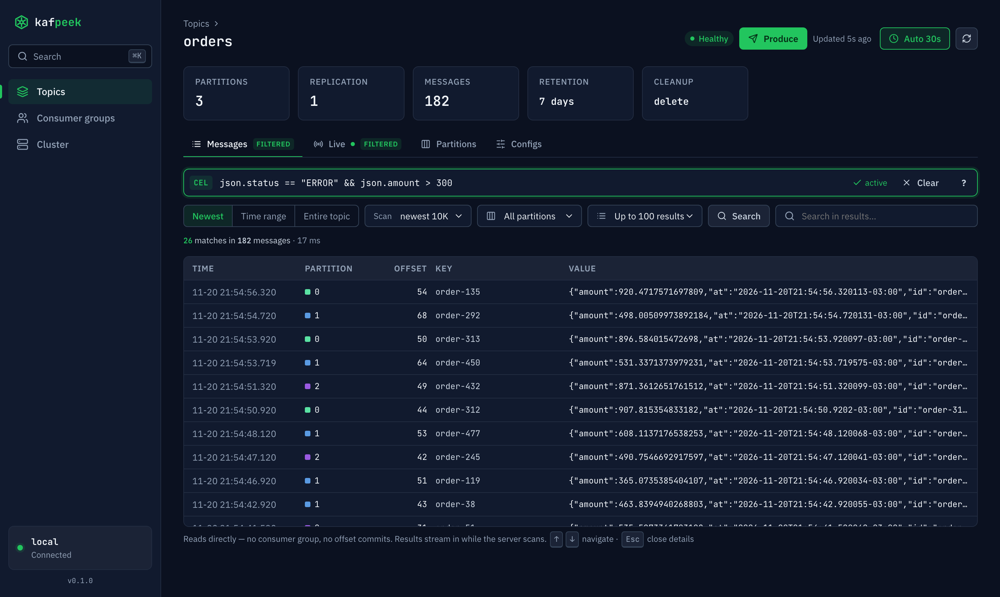

<p align="center">
  <a href="README.md">English</a> · <b>Português</b>
</p>

<div align="center">


# kafpeek

**Espie dentro dos seus tópicos Kafka.** UI leve para Apache Kafka: um único binário (ou imagem Docker de
~11 MB, ~18–21 MB de RAM) com busca de mensagens por filtros CEL no servidor, live tail e suporte a AWS MSK IAM.

[](LICENSE)
[](go.mod)
[](web/package.json)
[](https://hub.docker.com/r/stolato/kafpeek)
[](https://github.com/stolato/kafpeek/actions/workflows/release.yml)



</div>

## Por que kafpeek?

- **Encontre a mensagem certa rápido**: filtros [CEL](https://cel.dev) rodam **no servidor**, e só o que casa
  trafega até o navegador. Busca em streaming nas mais recentes, num intervalo de tempo ou no **tópico inteiro**,
  com progresso real e botão Stop.
- **Live tail** em tempo real, com os mesmos filtros.
- **Não interfere em nada**: a leitura nunca usa consumer group nem commita offsets.
- **Tudo num binário só**: backend Go ([franz-go](https://github.com/twmb/franz-go) + chi) com o frontend Angular
  embutido. Sem JVM, sem banco, sem dependências.
- **Conecta em qualquer cluster**: PLAINTEXT, TLS, mTLS, SASL/PLAIN, SCRAM e **AWS MSK IAM** (chaves, perfil/SSO
  ou role de ECS/EKS/EC2).
- Tópicos, partições, configs e consumer groups com lag (e tendência).
- **Produce** de mensagens com proteção para clusters de produção, ou modo **somente leitura**.
- Seguro por padrão: login (Basic Auth), proteção contra CSRF e DNS rebinding, CSP restritiva, usuário não-root.

---

## Sumário

1. [Início rápido](#início-rápido)
2. [Conexões suportadas](#conexões-suportadas)
3. [Docker em detalhe](#docker-em-detalhe)
4. [Referência de variáveis de ambiente](#referência-de-variáveis-de-ambiente)
5. [Segurança e login](#segurança-e-login)
6. [Filtros (CEL)](#filtros-cel)
7. [Produzindo mensagens](#produzindo-mensagens)
8. [Desenvolvimento](#desenvolvimento)
9. [API](#api)
10. [Arquitetura](#arquitetura)
11. [Contribuindo](#contribuindo)
12. [Licença](#licença)

---

## Início rápido

**Só quer experimentar?** Sobe um Kafka local e a UI em containers:

```bash
git clone https://github.com/stolato/kafpeek.git && cd kafpeek
make demo        # Kafka + kafpeek; abra http://localhost:8090
make seed        # opcional (requer Go): tópicos de exemplo com eventos fake
```

**Conectar no seu cluster com Docker:**

```bash
docker run -d --name kafpeek \
  -p 127.0.0.1:8090:8090 \
  -e KAFKA_CLUSTER_NAME=meu-cluster \
  -e KAFKA_BROKERS=broker1:9092,broker2:9092 \
  -e KAFKA_AUTH=none \
  stolato/kafpeek:latest
```

A imagem é publicada no [Docker Hub](https://hub.docker.com/r/stolato/kafpeek) (`stolato/kafpeek`) e no GitHub
Container Registry (`ghcr.io/stolato/kafpeek`), para `linux/amd64` e `linux/arm64`.

Abra **http://localhost:8090**. Para TLS, SASL ou MSK, veja [Conexões suportadas](#conexões-suportadas).

**Binário, sem Docker** (requer Go 1.27+ e Node 24+):

```bash
make build       # gera bin/kafpeek com a UI embutida
KAFKA_BROKERS=localhost:9092 ./bin/kafpeek
```

---

## Conexões suportadas

Resumo — escolha a linha do seu cluster e siga a seção correspondente:

| Cenário | `KAFKA_AUTH` | TLS | Exemplos |
|---|---|---|---|
| [Sem autenticação, sem TLS](#1-plaintext-sem-autenticação) | `none` | não | Kafka local, dev, rede interna |
| [Só TLS (criptografia)](#2-tls-sem-autenticação) | `none` | sim | MSK porta 9094 sem auth de cliente |
| [TLS com CA privada](#3-tls-com-ca-privada) | qualquer | sim + `KAFKA_TLS_CA_FILE` | Kafka próprio, Strimzi, Aiven |
| [mTLS (certificado de cliente)](#4-mtls-certificado-de-cliente) | `none` | sim + cert/key | MSK mTLS (9094/9194), Strimzi, Aiven |
| [SASL/PLAIN](#5-saslplain) | `plain` | sim (padrão) | Confluent Cloud, Azure Event Hubs |
| [SASL/SCRAM](#6-saslscram-sha-256--sha-512) | `scram-sha-512` / `scram-sha-256` | sim (padrão) | MSK SCRAM (9096/9196), Aiven, Redpanda, Strimzi |
| [AWS MSK IAM](#7-aws-msk-com-iam) | `aws-iam` | sim (obrigatório) | MSK provisionado (9098/9198), MSK Serverless |

Regras gerais:
- `KAFKA_BROKERS` aceita vários brokers separados por vírgula (`host:porta`). Basta um alcançável — o resto é descoberto.
- **TLS liga sozinho** quando há SASL (`plain`, `scram-*`, `aws-iam`) ou certificados configurados.
  Force com `KAFKA_TLS=true|false`.
- A leitura nunca usa consumer group nem commita offsets — não interfere nos consumidores reais.

### 1) PLAINTEXT (sem autenticação)

```env
KAFKA_BROKERS=kafka:9092
KAFKA_AUTH=none
```

### 2) TLS sem autenticação

Tráfego criptografado, sem credencial do cliente. O certificado do broker é validado contra as CAs públicas
do sistema (incluídas na imagem).

```env
KAFKA_BROKERS=b-1.mycluster.xxxx.kafka.us-east-1.amazonaws.com:9094
KAFKA_AUTH=none
KAFKA_TLS=true
```

### 3) TLS com CA privada

Quando o broker usa certificado emitido por uma CA interna (erro típico sem isso:
`x509: certificate signed by unknown authority`):

```env
KAFKA_TLS_CA_FILE=/certs/ca.pem        # PEM; pode ter vários certificados
# KAFKA_TLS_SERVER_NAME=kafka.interno  # só se o nome no certificado diferir do host do broker
```

A CA é **somada** às CAs do sistema. Combina com qualquer `KAFKA_AUTH` (ex.: SCRAM + CA privada).

- **Strimzi**: `kubectl get secret <cluster>-cluster-ca-cert -o jsonpath='{.data.ca\.crt}' | base64 -d > ca.pem`
- **Aiven**: baixe o `ca.pem` no console do serviço.

> `KAFKA_TLS_INSECURE_SKIP_VERIFY=true` desliga a validação do certificado. **Só para testes** — permite
> ataques man-in-the-middle.

### 4) mTLS (certificado de cliente)

O cliente se autentica com certificado (PEM). Se o broker usa CA privada, informe-a também.

```env
KAFKA_BROKERS=b-1.mycluster.xxxx.kafka.us-east-1.amazonaws.com:9094
KAFKA_AUTH=none
KAFKA_TLS_CERT_FILE=/certs/client.pem
KAFKA_TLS_KEY_FILE=/certs/client.key
KAFKA_TLS_CA_FILE=/certs/ca.pem        # se a CA do broker for privada
```

- **MSK com autenticação TLS (AWS Private CA)**: portas **9094** (VPC) / **9194** (público). O certificado do
  cliente é emitido pela sua AWS Private CA; o broker do MSK usa certificado público, então `KAFKA_TLS_CA_FILE`
  normalmente não é necessário.
- **Strimzi** (`KafkaUser` com `authentication: tls`): `user.crt` / `user.key` do secret do usuário + CA do cluster.
- **Aiven**: `service.cert`, `service.key` e `ca.pem` do console.
- Chaves em formato **PKCS#12/JKS** precisam ser convertidas para PEM:
  `openssl pkcs12 -in client.p12 -out client.pem -clcerts -nokeys` e `... -out client.key -nocerts -nodes`.

### 5) SASL/PLAIN

```env
KAFKA_AUTH=plain
KAFKA_USERNAME=...
KAFKA_PASSWORD=...
```

- **Confluent Cloud**: bootstrap `pkc-xxxxx.<região>.<cloud>.confluent.cloud:9092`, usuário = **API key**,
  senha = **API secret**.
- **Azure Event Hubs** (endpoint Kafka, tier Standard ou superior): bootstrap `<namespace>.servicebus.windows.net:9093`,
  `KAFKA_USERNAME=$ConnectionString` (literal), `KAFKA_PASSWORD=<connection string do namespace>`.
  **No arquivo `.env`, use aspas simples** — `KAFKA_USERNAME='$ConnectionString'` —, senão o `$` é tratado como
  variável e o valor vira `onnectionString`, com falha de login sem explicação. (Em `docker --env-file` e em
  `-e` não precisa: lá o `$` é literal; no shell, use aspas simples.) Event Hubs implementa só
  parte das APIs de administração do Kafka; algumas telas (configs, consumer groups) podem vir incompletas.

> PLAIN envia a senha ao broker — só use com TLS (é o padrão).

### 6) SASL/SCRAM (SHA-256 / SHA-512)

```env
KAFKA_AUTH=scram-sha-512     # ou scram-sha-256, conforme o cluster
KAFKA_USERNAME=...
KAFKA_PASSWORD=...
```

- **AWS MSK SCRAM**: sempre `scram-sha-512`, portas **9096** (VPC) / **9196** (público). Usuário/senha vêm de um
  secret do Secrets Manager associado ao cluster.
- **Aiven**: `scram-sha-256`, porta SASL do serviço (+ `KAFKA_TLS_CA_FILE` com o `ca.pem` do Aiven).
- **Redpanda Cloud**: `scram-sha-256` ou `scram-sha-512`, conforme o usuário criado.
- **Strimzi** (`authentication: scram-sha-512`): senha no secret do `KafkaUser` + CA do cluster.

### 7) AWS MSK com IAM

**Resumo: o que passar**

| Variável | Obrigatória? | Valor |
|---|---|---|
| `KAFKA_AUTH` | sim | `aws-iam` |
| `KAFKA_BROKERS` | sim | Bootstrap **IAM** do cluster (porta **9098** na VPC, **9198** acesso público), separados por vírgula |
| `KAFKA_CLUSTER_NAME` | não | Nome exibido na UI (ex.: `msk-prod`) |
| `KAFKA_READ_ONLY` | não (recomendado) | `true` para bloquear o Produce |
| `AWS_REGION` | só na exceção abaixo | Região de assinatura, usada **somente** quando o hostname do broker não a contém (ex.: DNS/CNAME próprio para os brokers) |
| Credenciais AWS | sim, **uma** das opções abaixo | Chaves, perfil/SSO ou role da plataforma |

Não precisa de `KAFKA_TLS` (liga sozinho com `aws-iam`), nem de `KAFKA_USERNAME`/`KAFKA_PASSWORD`. Para os
hostnames padrão do MSK (`b-1.<cluster>.<id>.kafka.<região>.amazonaws.com`) a região é lida do hostname, então
`AWS_REGION` não é necessária. Se os brokers usarem nomes próprios sem a região, defina `AWS_REGION=<região>`.

O bootstrap fica em *AWS Console → MSK → cluster → View client information* ou em
`aws kafka get-bootstrap-brokers --cluster-arn <arn>` (campos `BootstrapBrokerStringSaslIam` /
`BootstrapBrokerStringPublicSaslIam`).

**Credenciais: escolha uma opção**

| Onde roda | Variáveis | Observação |
|---|---|---|
| **ECS / Fargate** | nenhuma | Usa a *task role* da task definition |
| **EKS** | nenhuma | IRSA (`serviceAccountName` anotado com a role) ou EKS Pod Identity |
| **EC2** | nenhuma | Usa o *instance profile* |
| Chave de acesso (usuário IAM) | `AWS_ACCESS_KEY_ID`, `AWS_SECRET_ACCESS_KEY` | Evite em produção: chave `AKIA...` de longa duração |
| Credencial temporária (STS) | `AWS_ACCESS_KEY_ID`, `AWS_SECRET_ACCESS_KEY`, `AWS_SESSION_TOKEN` | Expira; o container precisa ser reiniciado com novas credenciais |
| Perfil / SSO da máquina | `AWS_PROFILE` + `~/.aws` montado em `/home/nonroot/.aws` | Com SSO, rode `aws sso login` no host |
| Assumir outra role | `AWS_PROFILE` apontando para um perfil com `role_arn` + `source_profile` (ou `credential_source`) em `~/.aws/config` | `AWS_ROLE_ARN` sozinho **não** funciona: ele só vale junto com `AWS_WEB_IDENTITY_TOKEN_FILE` (caso do IRSA, que o EKS preenche sozinho) |

Use só uma opção. Se houver mais de uma, `AWS_PROFILE` (quando definido) tem prioridade; depois vêm
`AWS_ACCESS_KEY_ID`/`AWS_SECRET_ACCESS_KEY`, web identity (IRSA), o perfil padrão de `~/.aws` e, por último,
a role do ECS/EC2. As credenciais
temporárias de roles/SSO são renovadas sozinhas a cada reautenticação.

**Exemplo: chave de acesso (arquivo `kafpeek.env`)**

```env
KAFKA_CLUSTER_NAME=msk-prod
KAFKA_AUTH=aws-iam
KAFKA_BROKERS=b-1-public.mycluster.xxxx.c3.kafka.sa-east-1.amazonaws.com:9198,b-2-public.mycluster.xxxx.c3.kafka.sa-east-1.amazonaws.com:9198
KAFKA_READ_ONLY=true
AWS_ACCESS_KEY_ID=AKIA...
AWS_SECRET_ACCESS_KEY=...
# AWS_SESSION_TOKEN=...   # só para credenciais temporárias

UI_USERNAME=admin
UI_PASSWORD=troque-isto
ALLOWED_HOSTS=kafpeek.minhaempresa.internal
```

```bash
docker run -d --name kafpeek -p 8090:8090 --env-file kafpeek.env stolato/kafpeek:latest
```

**Exemplo: perfil / SSO da sua máquina**

```bash
docker run -d --name kafpeek -p 127.0.0.1:8090:8090 \
  -v ~/.aws:/home/nonroot/.aws \
  -e AWS_PROFILE=meu-perfil \
  -e KAFKA_CLUSTER_NAME=msk-prod -e KAFKA_AUTH=aws-iam \
  -e KAFKA_BROKERS=b-1-public.mycluster.xxxx.c3.kafka.sa-east-1.amazonaws.com:9198 \
  stolato/kafpeek:latest
```

Com **SSO**, monte `~/.aws` com escrita (sem `:ro`) para o cache do token poder ser renovado.

**Exemplo: ECS / EKS / EC2 (role da plataforma)**

```env
KAFKA_CLUSTER_NAME=msk-prod
KAFKA_AUTH=aws-iam
KAFKA_BROKERS=b-1.mycluster.xxxx.c3.kafka.sa-east-1.amazonaws.com:9098,b-2.mycluster.xxxx.c3.kafka.sa-east-1.amazonaws.com:9098
KAFKA_READ_ONLY=true
# nenhuma variável AWS_*: a role da task/pod/instância é usada automaticamente
```

**Portas do MSK** (cada autenticação tem seu bootstrap):

| Autenticação | Dentro da VPC | Acesso público |
|---|---|---|
| IAM | 9098 | **9198** |
| SASL/SCRAM | 9096 | 9196 |
| TLS / mTLS | 9094 | 9194 |
| Sem auth (plaintext) | 9092 | — |

**MSK Serverless**: só IAM, porta 9098, apenas dentro da VPC.

**Permissões IAM** da identidade usada (troque região, conta, nome e UUID do cluster):

```json
{
  "Version": "2012-10-17",
  "Statement": [
    {
      "Effect": "Allow",
      "Action": ["kafka-cluster:Connect", "kafka-cluster:DescribeCluster"],
      "Resource": "arn:aws:kafka:sa-east-1:123456789012:cluster/mycluster/<uuid>"
    },
    {
      "Effect": "Allow",
      "Action": [
        "kafka-cluster:DescribeTopic",
        "kafka-cluster:DescribeTopicDynamicConfiguration",
        "kafka-cluster:ReadData"
      ],
      "Resource": "arn:aws:kafka:sa-east-1:123456789012:topic/mycluster/<uuid>/*"
    },
    {
      "Effect": "Allow",
      "Action": ["kafka-cluster:DescribeGroup"],
      "Resource": "arn:aws:kafka:sa-east-1:123456789012:group/mycluster/<uuid>/*"
    }
  ]
}
```

Para usar o Produce, inclua `kafka-cluster:WriteData` no bloco de tópicos (e deixe `KAFKA_READ_ONLY` desligado).

**Erros comuns**

- *Timeout / não conecta*: o security group do MSK precisa liberar a porta (9098/9198) para onde o container
  roda; acesso público precisa estar habilitado no cluster para usar 9198.
- *`loading AWS credentials` / `retrieving AWS credentials`*: nenhuma credencial foi encontrada (variável
  faltando, `~/.aws` não montado, SSO expirado: rode `aws sso login`).
- *Conecta mas não lista tópicos / `access denied`*: falta permissão na policy acima ou o ARN do recurso está
  errado.
- *Porta errada* (ex.: 9096 com `aws-iam`): use o bootstrap **IAM**, não o de SCRAM/TLS.

Use `LOG_LEVEL=debug` para ver os detalhes da conexão.

### O que não é suportado (ainda)

- **SASL/OAUTHBEARER (OIDC)** — ex.: Confluent Cloud com OAuth, Event Hubs com Entra ID. Use API key/connection string.
- **SASL/GSSAPI (Kerberos)**.
- **Schema Registry** (Avro/Protobuf) — mensagens binárias aparecem em base64.
- **Vários clusters** na mesma instância — rode uma instância por cluster.

### Diagnóstico de conexão

O log de inicialização mostra o erro real do Kafka. Os mais comuns:

| Sintoma no log | Causa provável |
|---|---|
| `dial tcp ...: i/o timeout` | Rede: VPN, security group/firewall, ou **porta errada para o tipo de auth** (o app avisa quando detecta isso no MSK) |
| `connection refused` | Host/porta errados ou broker fora do ar |
| `x509: certificate signed by unknown authority` | CA privada → `KAFKA_TLS_CA_FILE` |
| `SASL_AUTHENTICATION_FAILED` / `ILLEGAL_SASL_STATE` | Usuário/senha, mecanismo (`scram-sha-256` × `512`) ou chave AWS errados |
| `TOPIC_AUTHORIZATION_FAILED` / `CLUSTER_AUTHORIZATION_FAILED` | Falta permissão IAM/ACL |
| `broker closed the connection immediately after a dial, which often happens if the client is using TLS when the broker is not expecting it` | TLS ligado num listener sem TLS → `KAFKA_TLS=false` (ou porta errada) |
| `tls: first record does not look like a TLS handshake` | O inverso: listener com TLS e `KAFKA_TLS=false` |
| `KAFKA_TLS_CA_FILE ...: no PEM certificates found` | Arquivo não é PEM (converta DER/PKCS#12 com `openssl`) |

`LOG_LEVEL=debug` mostra todos os passos da conexão.

---

## Docker em detalhe

A imagem é **distroless** (sem shell), roda como usuário **não-root** (`65532`), tem ~11 MB e usa ~18–21 MB de RAM em repouso ou com live tail, inclui as CAs
públicas e um `HEALTHCHECK` (`/kafpeek healthcheck`). Arquiteturas: `linux/amd64` e `linux/arm64`.

### Com arquivo de variáveis

```bash
docker run -d --name kafpeek -p 127.0.0.1:8090:8090 --env-file kafpeek.env stolato/kafpeek:latest
```

### AWS MSK IAM

Variáveis, exemplos de `docker run`/env-file para chave de acesso, perfil/SSO e roles (ECS/EKS/EC2), e a
policy IAM: veja [7) AWS MSK com IAM](#7-aws-msk-com-iam).

### Certificados (CA privada / mTLS)

```bash
docker run -d --name kafpeek -p 127.0.0.1:8090:8090 \
  -v ./certs:/certs:ro \
  -e KAFKA_TLS_CA_FILE=/certs/ca.pem \
  -e KAFKA_TLS_CERT_FILE=/certs/client.pem \
  -e KAFKA_TLS_KEY_FILE=/certs/client.key \
  ...
```

Os arquivos precisam ser legíveis pelo usuário `65532` (`chmod 644`, ou `644` no cert e `640` + grupo na chave).

### Docker Compose (produção)

```yaml
services:
  kafpeek:
    image: stolato/kafpeek:0.1.1
    restart: unless-stopped
    ports:
      - "127.0.0.1:8090:8090"
    env_file: kafpeek.env          # KAFKA_*, UI_USERNAME, UI_PASSWORD...
    read_only: true                 # o app não escreve em disco
    security_opt: ["no-new-privileges:true"]
```

### Kubernetes (esboço)

```yaml
apiVersion: apps/v1
kind: Deployment
metadata: { name: kafpeek }
spec:
  replicas: 1
  selector: { matchLabels: { app: kafpeek } }
  template:
    metadata: { labels: { app: kafpeek } }
    spec:
      serviceAccountName: kafpeek        # com IRSA/Pod Identity para MSK IAM
      securityContext: { runAsNonRoot: true }
      containers:
        - name: kafpeek
          image: stolato/kafpeek:0.1.1
          ports: [{ containerPort: 8090 }]
          envFrom: [{ secretRef: { name: kafpeek-env } }]
          env:
            - { name: ALLOWED_HOSTS, value: "kafpeek.minhaempresa.internal" }
            - { name: TRUST_PROXY, value: "true" }   # atrás do Ingress
          readinessProbe: { exec: { command: ["/kafpeek", "healthcheck"] } }
          livenessProbe:  { exec: { command: ["/kafpeek", "healthcheck"] } }
          securityContext: { readOnlyRootFilesystem: true, allowPrivilegeEscalation: false }
```

### Expondo na rede

Dentro do container o app escuta em `0.0.0.0:8090` (obrigatório para o port mapping funcionar). Quem controla
a exposição é o mapeamento de porta:

- `-p 127.0.0.1:8090:8090` → só a própria máquina (recomendado sem login).
- `-p 8090:8090` → toda a rede. Nesse caso **defina `UI_USERNAME`/`UI_PASSWORD`**, coloque **HTTPS** na frente
  (load balancer / Ingress / proxy) e liste em `ALLOWED_HOSTS` o hostname usado para acessar — hosts não
  listados recebem 403 (proteção contra DNS rebinding).

### Gerando e publicando a imagem

```bash
make image                                   # imagem local (docker ou podman, detectado)
make image-push IMAGE=registry.exemplo.com/kafpeek   # multi-arch (amd64+arm64), requer Docker com buildx
```

A versão vem do arquivo `VERSION`; o commit e a data do build entram automaticamente.

**Releases oficiais** são publicadas pelo GitHub Actions ([`release.yml`](.github/workflows/release.yml)):
ao enviar uma tag `vX.Y.Z` igual ao arquivo `VERSION`, os testes rodam e a imagem multi-arch vai para o
Docker Hub e o GHCR com as tags `X.Y.Z`, `X.Y` e `latest`.

```bash
echo 0.2.0 > VERSION && git commit -am "Release v0.2.0"
git tag -a v0.2.0 -m "kafpeek v0.2.0" && git push origin main v0.2.0
```
`docker run --rm <imagem> version` mostra a versão embutida.

---

## Referência de variáveis de ambiente

Fora do Docker, o app também lê um arquivo `.env` no diretório atual (variáveis reais têm prioridade).
Modelo completo em [`.env.example`](.env.example).

**Kafka**

| Variável | Padrão | Descrição |
|---|---|---|
| `KAFKA_BROKERS` | `localhost:9092` | Brokers `host:porta`, separados por vírgula |
| `KAFKA_CLUSTER_NAME` | `default` | Nome exibido na UI. Contendo `prod`, o Produce pede confirmação extra |
| `KAFKA_AUTH` | `none` | `none`, `plain`, `scram-sha-256`, `scram-sha-512`, `aws-iam` |
| `KAFKA_USERNAME` / `KAFKA_PASSWORD` | — | Credenciais para `plain` e `scram-*` |
| `KAFKA_TLS` | automático | `true` se houver SASL ou certificados; senão `false` |
| `KAFKA_TLS_CA_FILE` | — | CA(s) PEM extra(s) para validar o broker |
| `KAFKA_TLS_CERT_FILE` / `KAFKA_TLS_KEY_FILE` | — | Certificado e chave PEM do cliente (mTLS) |
| `KAFKA_TLS_SERVER_NAME` | host do broker | Nome para SNI/validação do certificado |
| `KAFKA_TLS_INSECURE_SKIP_VERIFY` | `false` | Desliga a validação do certificado (só testes) |
| `KAFKA_READ_ONLY` | `false` | Desliga toda escrita (Produce) |

**AWS (para `aws-iam`)**: veja [7) AWS MSK com IAM](#7-aws-msk-com-iam) para quais usar em cada caso.

| Variável | Descrição |
|---|---|
| `AWS_ACCESS_KEY_ID` / `AWS_SECRET_ACCESS_KEY` | Chave de acesso |
| `AWS_SESSION_TOKEN` | Só para credenciais temporárias (STS) |
| `AWS_PROFILE` | Perfil de `~/.aws` (SSO, `role_arn`...) |
| `AWS_CONFIG_FILE` / `AWS_SHARED_CREDENTIALS_FILE` | Caminhos alternativos para `~/.aws/config` / `credentials` |
| `AWS_ROLE_ARN` + `AWS_WEB_IDENTITY_TOKEN_FILE` | Web identity (IRSA); o EKS preenche sozinho |
| `AWS_REGION` | Região de assinatura de fallback, usada só quando o hostname do broker não contém a região (hostnames padrão do MSK não precisam). `AWS_DEFAULT_REGION` também é aceita |

ECS, EKS e EC2 fornecem credenciais pela role da plataforma, sem variáveis.

**Servidor / segurança**

| Variável | Padrão | Descrição |
|---|---|---|
| `HTTP_ADDR` | `127.0.0.1:8090` (binário) / `0.0.0.0:8090` (imagem) | Endereço de escuta |
| `UI_USERNAME` / `UI_PASSWORD` | — | Ativam o login (as duas são obrigatórias juntas) |
| `ALLOWED_HOSTS` | `localhost,127.0.0.1,::1` | Hosts extras aceitos (hostname/IP de acesso). `*` desliga a verificação |
| `TRUST_PROXY` | `false` | Usa `X-Forwarded-For` para o IP do cliente (só atrás de proxy) |
| `LOG_LEVEL` | `info` | `debug` para detalhes de conexão |

---

## Segurança e login

```env
UI_USERNAME=admin
UI_PASSWORD=uma-senha-forte
```

- Login por **HTTP Basic Auth** em todas as rotas (UI, API e streams). Sem as duas variáveis, a UI fica aberta
  (o log avisa); com só uma, o app não sobe. Senha errada responde com atraso (anti força bruta).
  Não há logout — feche o navegador.
- **Basic Auth envia a senha a cada requisição**: fora de localhost/VPN, use HTTPS na frente.
- Escritas (Produce) exigem `Content-Type: application/json` e são **bloqueadas quando vêm de outro site** (CSRF).
- Hosts desconhecidos recebem 403 (**DNS rebinding**) — configure `ALLOWED_HOSTS`.
- Headers: CSP restritiva (sem JS inline, sem iframe), `nosniff`, `no-referrer`; respostas da API com `no-store`.
- `KAFKA_READ_ONLY=true` é recomendado em instalações compartilhadas.

---

## Filtros (CEL)

Os filtros rodam **no servidor** com [CEL](https://cel.dev). Só as mensagens que casam chegam ao navegador.
Funcionam na aba Messages e na aba Live e ficam na URL (`?filter=`), então dá para compartilhar por link.

| Variável | Tipo | |
|---|---|---|
| `json` | dyn | value parseado como JSON (`null` se não for JSON) |
| `value` / `key` | string | conteúdo bruto (base64 se for binário) |
| `headers` | map(string,string) | `headers["tenant"]` |
| `partition`, `offset`, `size` | int | |
| `timestamp` | timestamp | |

```
json.status == "ERROR" && json.amount > 500
has(json.error) || value.matches("(?i)exception")
headers["tenant"] == "acme" && key.startsWith("order-")
json.items.exists(i, i.qty > 10)
timestamp > timestamp("2026-11-19T17:00:00Z")
```

Na aba **Messages** a busca é em **streaming**: resultados aparecem enquanto o servidor varre, com barra de
progresso real e botão **Stop** (mantém o que já foi encontrado). Alcances: **Newest** (N mais recentes),
**Time range** (de/até, atalhos 15 min / 1 h / 6 h / 24 h) e **Entire topic** (só roda ao clicar em Search).
Limite de até 10.000 resultados por busca; máximo de 4 buscas simultâneas no servidor.

Uma expressão que dá erro numa mensagem (ex.: campo JSON ausente) conta como "não casou". No Live, clientes com
filtros diferentes compartilham um único consumer e cada expressão distinta é avaliada uma vez por mensagem.

---

## Produzindo mensagens

Botão **Produce** no tópico (ou **Produce copy** numa mensagem, para reprocessá-la): key, value (JSON validado ou
texto), headers, partição automática (mesmo hash do cliente Java) ou fixa, tombstone (`null`).
Clusters com `prod` no nome exigem confirmação a cada abertura. Desative tudo com `KAFKA_READ_ONLY=true`.
No MSK IAM é preciso `kafka-cluster:WriteData`.

---

## Desenvolvimento

```bash
cp .env.example .env
make kafka-up      # Kafka local (KRaft) via docker/podman compose
make seed          # outro terminal: tópicos de exemplo + eventos fake (só local)
make run           # API em http://localhost:8090
make web-dev       # outro terminal: Angular com hot reload em http://localhost:4200
make build         # bin/kafpeek com a UI embutida
make demo          # Kafka + kafpeek em containers
```

Testes: `go test -race ./internal/...`

---

## API

| Método | Rota | Descrição |
|---|---|---|
| GET | `/api/health` | status, cluster, read-only e versão |
| GET | `/api/cluster` | cluster ID, controller, brokers |
| GET | `/api/topics` | tópicos com partições, RF, mensagens (aprox.) e saúde |
| GET | `/api/topics/{name}` | partições, offsets e configs |
| GET | `/api/topics/{name}/messages?limit=100&partition=0` | últimas N mensagens |
| GET | `/api/topics/{name}/search?filter=<CEL>&mode=newest\|range\|all&scan=N&from=&to=&limit=N` | **SSE**: busca em streaming (`start`, `batch`, `done`, `failure`); fechar a conexão cancela a varredura |
| GET | `/api/topics/{name}/live?filter=<CEL>` | **SSE**: tempo real (`ready`, `batch`, `failure`) |
| POST | `/api/topics/{name}/messages` | produz uma mensagem `{key, value, headers, partition?}` (403 em read-only) |
| GET | `/api/filter/validate?expr=<CEL>` | valida a expressão: `200` ou `400 {"error","column"}` |
| GET | `/api/consumer-groups` | grupos com lag total |
| GET | `/api/consumer-groups/{name}` | lag por partição |
| GET | `/api/streams` | streams ao vivo ativos |

---

## Arquitetura

```
cmd/kafpeek        entrypoint (config, servidor HTTP, healthcheck, graceful shutdown)
cmd/seed           gerador de dados de teste (só para o Kafka local)
internal/config    configuração via env/.env
internal/kafka     fachada sobre franz-go (kgo/kadm): conexão/TLS/SASL, leitura, busca, produce
internal/filter    compilação/avaliação de filtros CEL
internal/stream    hub de tempo real: 1 consumer por tópico → N clientes, com backpressure
internal/api       rotas chi, REST + SSE, segurança (auth, CSRF, hosts, headers)
internal/version   versão/commit/data embutidos no build
web/               Angular (embutido via embed.FS a partir de web/dist)
```

---

## Contribuindo

Issues e pull requests são bem-vindos. Para mudanças maiores, abra uma issue antes para alinharmos a ideia.

1. Faça um fork e crie uma branch (`git checkout -b minha-melhoria`).
2. Suba o ambiente local (veja [Desenvolvimento](#desenvolvimento)).
3. Rode os testes: `go test -race ./...` e `cd web && npx ng build`.
4. Abra o pull request descrevendo o que mudou e como testar.

---

## Licença

Distribuído sob a licença [MIT](LICENSE).

Apache Kafka é marca registrada da Apache Software Foundation. O kafpeek é um projeto independente, sem
afiliação com a ASF.
