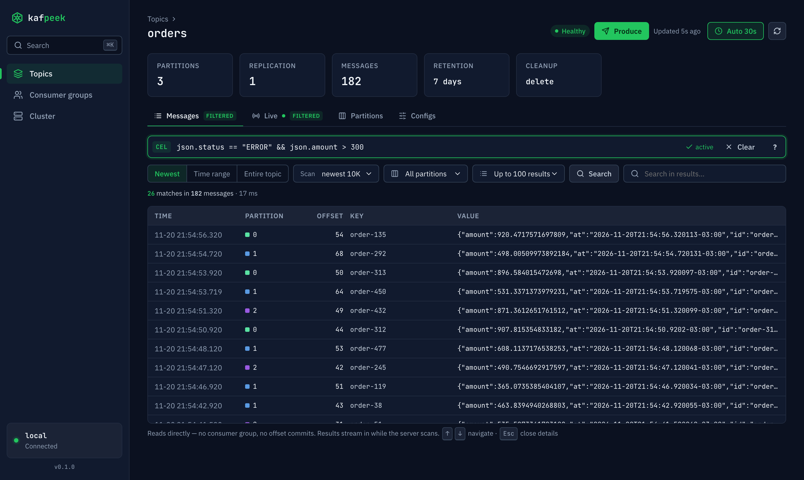

# kafpeek

**Espie dentro dos seus tópicos Kafka.** UI leve para Apache Kafka: um único binário Go com a interface
embutida, numa imagem distroless de ~11 MB, usando ~18–21 MB de RAM em repouso ou com live tail. Busca de mensagens com filtros CEL no servidor, live tail e
suporte a AWS MSK IAM.



**Código, documentação completa e issues:** [github.com/stolato/kafpeek](https://github.com/stolato/kafpeek)

## Recursos

- **Filtros [CEL](https://cel.dev) no servidor**: só as mensagens que casam trafegam até o navegador.
  Ex.: `json.status == "ERROR" && json.amount > 500`
- **Busca em streaming** nas mais recentes, num intervalo de tempo ou no **tópico inteiro**, com progresso real
- **Live tail** em tempo real com os mesmos filtros
- Tópicos, partições, configs e consumer groups com lag
- **Produce** de mensagens com proteção para produção, ou modo somente leitura
- **Não interfere em nada**: a leitura nunca usa consumer group nem commita offsets
- PLAINTEXT, TLS, mTLS, SASL/PLAIN, SCRAM e **AWS MSK IAM**
- Login (Basic Auth), proteção contra CSRF e DNS rebinding, CSP restritiva, usuário não-root

## Tags

| Tag | Descrição |
|---|---|
| `latest` | Última versão estável |
| `X.Y.Z` (ex.: `0.1.1`) | Versão exata (recomendado em produção) |
| `X.Y` (ex.: `0.1`) | Última correção da série |

Arquiteturas: `linux/amd64` e `linux/arm64`. Também em `ghcr.io/stolato/kafpeek`.

## Início rápido

```bash
docker run -d --name kafpeek \
  -p 127.0.0.1:8090:8090 \
  -e KAFKA_CLUSTER_NAME=meu-cluster \
  -e KAFKA_BROKERS=broker1:9092,broker2:9092 \
  stolato/kafpeek:latest
```

Abra **http://localhost:8090**.

### AWS MSK com IAM

```bash
docker run -d --name kafpeek -p 127.0.0.1:8090:8090 \
  -e KAFKA_CLUSTER_NAME=msk-prod \
  -e KAFKA_AUTH=aws-iam \
  -e KAFKA_BROKERS=b-1.mycluster.xxxx.c3.kafka.sa-east-1.amazonaws.com:9098 \
  -e KAFKA_READ_ONLY=true \
  -e AWS_ACCESS_KEY_ID=... -e AWS_SECRET_ACCESS_KEY=... \
  stolato/kafpeek:latest
```

Em ECS, EKS ou EC2, omita as variáveis `AWS_*`: a role da task, do pod ou da instância é usada
automaticamente. Para perfil/SSO, monte `~/.aws` em `/home/nonroot/.aws` e defina `AWS_PROFILE`.

### SASL/SCRAM (MSK, Aiven, Redpanda...)

```bash
docker run -d --name kafpeek -p 127.0.0.1:8090:8090 \
  -e KAFKA_BROKERS=broker:9096 \
  -e KAFKA_AUTH=scram-sha-512 \
  -e KAFKA_USERNAME=... -e KAFKA_PASSWORD=... \
  stolato/kafpeek:latest
```

### Exposto na rede (com login)

```bash
docker run -d --name kafpeek -p 8090:8090 \
  -e KAFKA_BROKERS=broker:9092 \
  -e UI_USERNAME=admin -e UI_PASSWORD=uma-senha-forte \
  -e ALLOWED_HOSTS=kafpeek.minhaempresa.internal \
  stolato/kafpeek:latest
```

Coloque HTTPS na frente (load balancer, Ingress ou proxy): o Basic Auth envia a senha a cada requisição.

## Variáveis de ambiente

| Variável | Padrão | Descrição |
|---|---|---|
| `KAFKA_BROKERS` | `localhost:9092` | Brokers `host:porta`, separados por vírgula |
| `KAFKA_CLUSTER_NAME` | `default` | Nome exibido na UI. Contendo `prod`, o Produce pede confirmação extra |
| `KAFKA_AUTH` | `none` | `none`, `plain`, `scram-sha-256`, `scram-sha-512`, `aws-iam` |
| `KAFKA_USERNAME` / `KAFKA_PASSWORD` | — | Credenciais para `plain` e `scram-*` |
| `KAFKA_TLS` | automático | Liga sozinho com SASL ou certificados |
| `KAFKA_TLS_CA_FILE` | — | CA(s) PEM extra(s) para validar o broker |
| `KAFKA_TLS_CERT_FILE` / `KAFKA_TLS_KEY_FILE` | — | Certificado e chave PEM do cliente (mTLS) |
| `KAFKA_READ_ONLY` | `false` | Desliga toda escrita (recomendado em produção) |
| `UI_USERNAME` / `UI_PASSWORD` | — | Ativam o login (as duas juntas) |
| `ALLOWED_HOSTS` | `localhost,127.0.0.1,::1` | Hostnames/IPs usados para acessar a UI |
| `TRUST_PROXY` | `false` | Usa `X-Forwarded-For` (só atrás de proxy) |
| `LOG_LEVEL` | `info` | `debug` para detalhes de conexão |
| `AWS_*` | — | Credenciais AWS padrão para `aws-iam` |

Lista completa, cenários de conexão (TLS, mTLS, Confluent Cloud, Azure Event Hubs...) e a policy IAM para MSK
estão no [README do GitHub](https://github.com/stolato/kafpeek#readme).

## Sobre a imagem

- Base **distroless** (`gcr.io/distroless/static-debian12:nonroot`): sem shell, com as CAs públicas
- Roda como usuário **não-root** (`65532`) e não escreve em disco (compatível com `read_only: true`)
- Porta **8090**; `HEALTHCHECK` embutido (`/kafpeek healthcheck`)
- `docker run --rm stolato/kafpeek version` mostra a versão e o commit

## Licença

[MIT](https://github.com/stolato/kafpeek/blob/main/LICENSE). Apache Kafka é marca registrada da Apache
Software Foundation; o kafpeek é um projeto independente.
